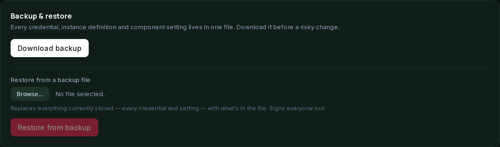

# Backups, history and updates

## Backups

All your settings live in one file: `$SUITE_DATA_DIR/suite.db`. It is created with
mode `0600`. It holds every credential, instance definition and component setting,
including API keys and VPN credentials, in plain text. Treat a copy the way you
would treat the `.env` file it replaces.

Everything else under `SUITE_DATA_DIR`, and under any cache path, is runtime state.
It is useful to keep but can be rebuilt. `suite.db` is the one that matters.

### Download and restore

Settings has a **Backup & restore** section.

- **Download backup** takes a consistent snapshot, using SQLite's `VACUUM INTO`, so
  a write in progress can never produce a torn copy. It then streams the snapshot
  to you.
- **Restore from backup** replaces the live file with one you upload. It closes the
  store, swaps the file, and reopens it. The Suite does not restart. A copy of the
  current file is kept first. If the upload turns out not to be a valid Suite
  database, that copy is restored, so the Suite keeps running.

Restoring an older backup also restores the admin password and sessions that were
current at the time. You will be signed out. Sign in with that backup's password if
it differs from your current one.

## Component history and rollback

Each time a component's configuration actually changes, the previous values are
kept. This covers the Stack page, instance edits, adoption, and anything else that
uses the same save path. Up to the last 10 versions are kept per component.

Each component's card, and each instance's edit panel, has a **History** section
listing the versions by time, each with a **Restore** button.

Restoring only changes what is stored. It does not touch Docker. The Stack page's
plan shows what the restore changed, usually a recreate. Applying it is a separate,
explicit step, the same as saving new values by hand. A restore is itself a save,
so it appears in history too. You can restore, then restore the version before
that.

## Checking for updates

A component's image is a specific tag, such as `qmcgaw/gluetun:latest` or
`postgres:14-alpine`. Tags are mutable. The same tag can point at new content when
the upstream project publishes a new build.

Changing the tag in a component's form triggers a recreate. Apply also pulls the
new image when the image value changed. What the Suite cannot do by itself is notice
that the same tag now points at a newer build.

Each component's card, and each instance row, has a **Check for updates** button. It
pulls that component's configured image. It recreates the container only if the pull
produced different content from what is running. A tag that has not changed upstream
does nothing.

Nothing is pulled unless you click the button. The plan runs on every page load and
must have no side effects.

The Suite is allowed to pull images only for component tags it already manages.
That is the one permission added to the Docker proxy since its first release. See
[stack management](stack-management.md) for how the proxy is set up.
