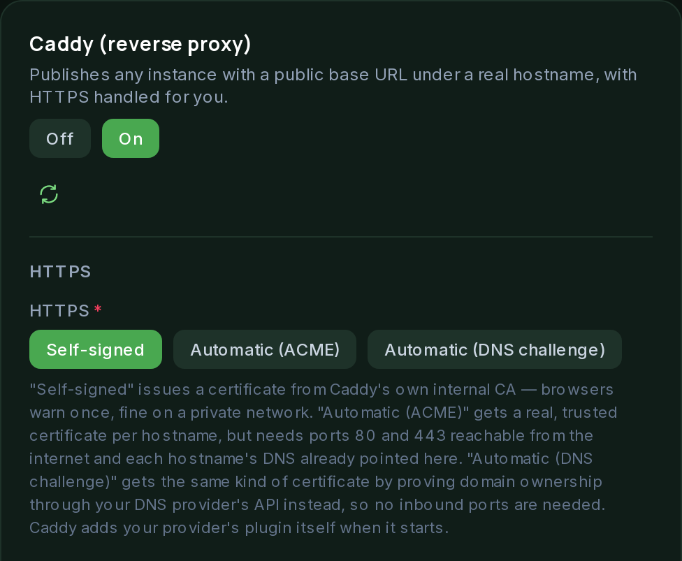

# Caddy (reverse proxy)

Caddy publishes an instance under a real hostname instead of a raw port, with
HTTPS handled for you. It is off by default. Most deployments publish nothing, so
it stays out of the plan until you switch it on under **Stack**.

## Routes come from instances

There is no separate field for routes. Caddy generates its configuration from
the instances that have a **Public base URL** set (under the instance's
Addressing group):

- The hostname becomes a site block.
- Any path becomes a path-based route.
- The target is the address the dashboard already computes for that instance.

An instance with no public base URL is not published. Two instances can share a
hostname on different paths. Each becomes its own route in the same site block.

## HTTPS modes

- **Self-signed:** Caddy's own internal CA. Browsers warn once. Fine on a private
  network.
- **Automatic (ACME):** a real, trusted certificate for each hostname. Needs ports
  80 and 443 reachable from the internet, and each hostname's DNS already pointing
  at this host.
- **Automatic (DNS challenge):** proves you own the domain through your DNS
  provider's API, so nothing needs to be reachable from the internet. See below.

Caddy joins the shared network, not gluetun's namespace. It reaches gluetun and
instances by name over Docker's DNS, which only needs the same network.

 

## Publishing the dashboard

Set **Dashboard public URL** on the Caddy component, for example
`https://suite.example.com`. Caddy proxies it to the Suite over the shared network.
The dashboard needs a hostname of its own, not a path. Publishing it also puts the
sign-in page on the internet.

## DNS challenge

Choose **Automatic (DNS challenge)** as the HTTPS setting. Then:

1. Enter the **Caddy module** for your DNS provider. Pick it yourself on the
   [Caddy download page](https://caddyserver.com/download), then pin it to a
   specific release, for example `github.com/caddy-dns/<provider>@v1.2.3`. Do not
   use `latest` or leave the version off.
2. Enter the **Directive**: everything after `dns` in the site's `tls` block, for
   example `<provider> {env.<PROVIDER>_API_TOKEN}`. Your module's documentation
   shows the exact form.
3. Fill in the **Provider environment variables** that appear for each
   `{env.NAME}` you reference.

Caddy then gets a `tls { dns ... }` block per site. The optional **Propagation
delay** (for example `30s`) makes Caddy wait after creating the DNS record. Slow
providers need this. It must be a Go duration such as `30s` or `1m30s`. Anything
else is ignored.

The token is stored write-only and passed to the Caddy container's environment.
The Caddyfile only contains the `{env.NAME}` placeholder.

**Always pin the module to a specific release.** Without a version, or with
`latest`, `add-package` can build the module's unreleased branch instead of a
release.

## How the plugin is installed

The stock `caddy:2-alpine` image has no DNS plugins. The Suite adds your module
with Caddy's own `caddy add-package`, and writes the directive into the Caddyfile.

- The build downloads when the Caddy container first starts, and again after an
  image upgrade or a module change. It is kept in Caddy's config folder, which is
  mounted from the Suite's data directory. Later recreates and restarts reuse it.
- If the download fails, the container exits and logs why, and Docker retries.
  Caddy never runs without the plugin. If HTTPS does not come up, check the Caddy
  container's log. Apply reports success once the container starts, not once the
  download finishes.
- The download always installs the latest Caddy release, whatever the image tag
  says. The `@version` pins the plugin only, not Caddy.
- An image that already includes the plugin skips the download.
- Caddy marks `add-package` as experimental, and the image must not set its own
  ENTRYPOINT in this mode.
