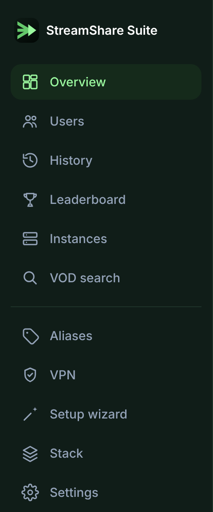

# Dashboard

Every part of the Suite is a page in the sidebar. On wide screens the sidebar
collapses to icons. On phones it becomes a drawer and a bottom bar.

*The sidebar. Pages with nothing to show yet stay hidden.*

The sidebar's version block shows what is running and marks a newer version
as `current → latest`. See
[checking for updates](backups-and-updates.md#checking-for-updates).

| Page | What it does |
| --- | --- |
| **Overview** | Live status of every instance: active streams and users, subscription status |
| **Users** | Known sessions: who is connected, and what they are playing |
| **History** | Searchable watch history across instances |
| **Leaderboard** | Top users and titles by watch time |
| **Instances** | Per-instance status and provider subscription detail |
| **VOD search** | Search movies and series across every Xtream instance. Copy the URL or start a download |
| **Aliases** | Give a viewer that shows up as a bare IP address a friendly name |
| **VPN** | gluetun status, reconnect, and the [VPN watchdog](vpn-watchdog.md) |
| **Setup wizard** | Guided first-time setup. See [setup wizard](setup-wizard.md) |
| **Stack** | Configure components and instances, review the plan, apply it. See [stack management](stack-management.md) |
| **Settings** | Poll interval, admin password, [API access](api.md), and [backup and restore](backups-and-updates.md) |

Pages with nothing to show stay hidden until they are useful. History, Users,
Leaderboard, VOD search and Aliases appear once an instance exists. VPN appears
once the VPN is switched on.
