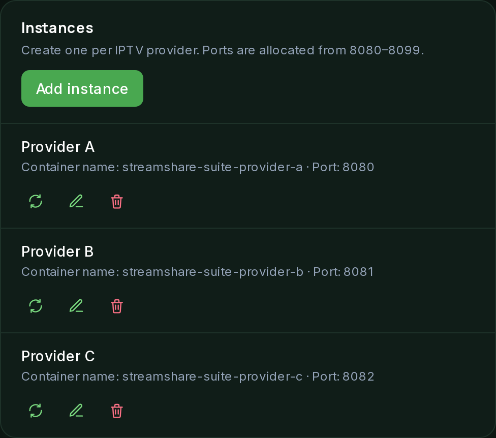

# Instances

An instance is one StreamShare server, usually one per IPTV provider. You add
and edit instances from a form. There is no compose file to edit.

## Adding an instance

Three things you would otherwise work out by hand are handled for you:

- **Port.** Allocated from a band of 20 ports, `8080`–`8099` by default. Move the
  band's start under **Stack** if those ports are taken on your host. An instance
  that already has a port keeps it. Allocation is sticky, so adding a fifth
  instance never renumbers the first four. That would recreate healthy containers
  for nothing and break anything pointing at them.
- **API key.** Generated and injected, so a new instance appears on the Overview
  page already authenticated.
- **Address.** Computed from your topology. With the VPN on, it is gluetun's
  address at the instance's port. With the VPN off, it is the container's own name.
  Flipping the VPN toggle updates every instance's address, because nothing about
  it was ever typed in.

Each instance gets its own database and role, created on first apply. An existing
database with that name is used as-is. It is never dropped or migrated.

## Editing

Click **Edit** on an instance's row to open the same form, filled in with its
current settings. The key is fixed at creation and never changes, even if you
rename the instance. A manually set port that clashes with another instance's is
rejected.

## Removing

Removing an instance is a deliberate action. You type the instance's name to
confirm. The container is stopped and removed as part of it. An adopted container
is the exception. The Suite never stops that one, so it stays running.

The container comes down before the database is touched. PostgreSQL refuses to
drop a database a container is still connected to. The database itself is kept
unless you tick the box and type the name again, because a container is easy to
rebuild and watch history is not.

## Settings

The form is grouped. Each group maps to something StreamShare can do:

- **Provider:** **Xtream API** unlocks VOD, series, EPG and subscription status.
  Use a plain **M3U playlist** for providers without an Xtream API. Choose once per
  instance. The fields for the other kind are hidden.
- **Access:** how your users sign in, by username and password or by **LDAP**
  (server, base DN, bind DN and password, optional required group). The add form
  also offers **Use my provider credentials**, which copies the Xtream login as the
  instance's sign-in. The same action is on an existing instance to reset it, since
  the Xtream password is never shown again.
- **Addressing:** the public base URL that Caddy publishes, and the timezone.
- **Discord:** an optional bot per instance, with its token and admin role ID. Its
  API address is computed from the public base URL.
- **Caching:** VOD caching, live **catchup** buffering (hours to keep), and the
  **cache location** on the host. Blank keeps it in the data directory. See
  [cache paths](configuration.md#cache-paths) before choosing your own.
- **Health check:** whether the [VPN watchdog](vpn-watchdog.md) probes this
  instance's provider, and which channel it uses. Search channel names (with their
  category, since names repeat) or enter a stream ID.
- **Error slates:** instead of a frozen picture or a dropped connection, viewers
  see the reason on screen when the provider fails. Override the message per HTTP
  status code, or per connection failure (`UNREACHABLE`, `TIMEOUT`, `DNS`, `TLS`),
  and adjust the retry window.
- **Container:** image, container name, port, and extra environment variables
  (under Advanced).

To publish an instance under a hostname, set its **Public base URL**. See
[Caddy](caddy.md).
