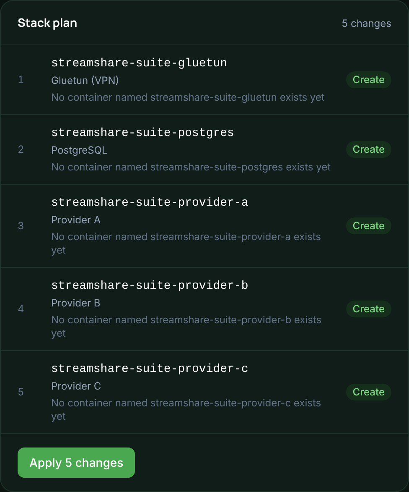

# Stack management

The **Stack** page is where you change what runs. It has two panes. On the left,
tabs for **Instances**, **Components** (gluetun, PostgreSQL, Caddy) and
**Import**. On the right, a **Plan** panel that always shows what applying would
do. Drag the divider to resize the panes. The Suite remembers the position.

## How changes are applied

Saving a configuration under **Stack** does not change Docker straight away. The
Suite renders a container spec, hashes it, and compares the hash with what is
deployed. Applying runs whatever the comparison calls for, as a background job
with a log you can watch.

Changes are reviewed across the whole stack, not one component at a time. Order
matters once components depend on each other. The plan is sorted by dependency,
and each row says whether you asked for it or it follows from something else.

*The plan panel on a fresh install: nothing exists in Docker yet, so every row is a Create.*

Every Docker call goes through
[`tecnativa/docker-socket-proxy`](https://github.com/Tecnativa/docker-socket-proxy),
which is included in `docker-compose.yml`. The Suite never touches
`/var/run/docker.sock` directly. The proxy allows only the calls the Suite needs
(containers, networks, create), and denies everything else. A service that can
create containers is effectively root on the host, so keeping this narrow is
deliberate.

## Plan outcomes

| Outcome | When | What happens |
| --- | --- | --- |
| **Create** | Nothing by that name exists | A new managed container is created and started |
| **No-op** | A managed container already matches | Nothing. Clicking Apply on every page load is safe |
| **Recreate** | A managed container's configuration has changed | Stop, remove, create, start. Anything sharing its network namespace briefly loses its connection |
| **Adopt** | A container exists but has none of the Suite's labels | Left running and untouched. Almost certainly one you set up by hand |
| **Orphaned** | The Suite created it, but its component has left the stack | Left running and reported. Removing it is a separate, confirmed action that Apply never performs |
| **Switched off** | Its component is disabled, but a container with that name is running and is not the Suite's | Left running and reported |

A **noop** row can still be a container stuck restarting. Each row also shows
what the inspect found: whether the container is running, its image, its restart
count, and its Docker healthcheck status if the image defines one.

**The cascade.** A container that shares gluetun's network namespace cannot
survive gluetun being replaced. Docker does not reattach it. So a plan that
recreates gluetun also recreates everything inside it, and marks those rows as a
cascade. Containers you only adopted get a warning instead, because recreating
them would be a takeover you did not ask for.

## Adopting an existing stack

Docker cannot add labels to a running container. So the Suite cannot bring an
existing container under management without either leaving it alone or replacing
it. By default it leaves it alone. **Take over anyway** on the Stack page replaces
it, and only when you click it.

Adoption is an exact name match. Each of gluetun, PostgreSQL and each instance has
a **Container name** field under Advanced. Set it to the name of a container you
already run, and the Suite adopts that one instead of planning a Create under its
own name.

Without an override, gluetun and PostgreSQL default to
`SUITE_CONTAINER_PREFIX` followed by `gluetun` or `postgres`
(`streamshare-suite-gluetun` and `streamshare-suite-postgres` by default). An
instance defaults to the prefix followed by its key.

## Importing from running containers

Adopting only leaves a container running. Its form stays blank until you fill it
in. **Import** fills it in for you. It reads the container's image, environment
and networks, and turns them into stored configuration, using each component's
own field-to-variable mapping in reverse. The container itself is never touched.

**Scan for existing containers** looks at every container on the host by image,
not by name. It lists containers the Suite does not already manage, and skips this
project's own images. Importing one:

- Recovers every field the schema can. For gluetun that means the VPN provider and
  keys. For PostgreSQL, the admin credentials. For an instance, its provider and
  access settings. It also sets a **Container name** override to the real name, so
  the container keeps being adopted.
- For an instance, keeps its existing API key and database credentials, read from
  its own `INTERNAL_API_KEY` and `DB_*` variables. The real database and role
  already use those values. Recreating the instance without importing it first
  would generate new ones and break access to that database.
- Puts anything the schema does not model into the **Extra environment variables**
  box, so nothing real is dropped.
- Refuses a container that was already imported, which would otherwise create a
  duplicate instance, and a singleton that is already configured. Overwrite only
  when you ask.

## Switched-off components and orphans

Switching the VPN off, or removing a component, can leave a container the Suite
created with no configuration behind. It shows up as orphaned and keeps running.
Apply never removes it. Removing it is a separate action with its own confirmation.

When the VPN is switched off, gluetun leaves the plan. A container the Suite
created becomes an orphan. A container you created yourself is reported as
switched off and left alone. Either way it stays on the page.

See [VPN](vpn.md) for switching the VPN on and off.

## Component history and updates

Every saved change is kept, up to the last 10 versions per component. You can
restore an older one. Restoring only changes what is stored, and Apply is still a
separate step. See [backups and updates](backups-and-updates.md).
