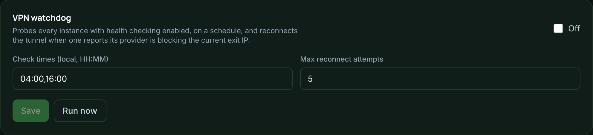

# VPN watchdog

Some providers block the exit IP your tunnel uses. The watchdog detects that and
reconnects gluetun to get a new one. It replaces the external `vpn-watchdog`
container from the [`stream-share`](https://github.com/x3n0n10/stream-share)
examples, so you do not need that container any more.

## Turning it on

*The watchdog card on the VPN page.*

Enable it on the **VPN** page. It then probes every instance that has **Watch
this instance's provider** turned on. That setting is under the instance's
**Health check** group, alongside:

- **Probe channel id:** a live channel ID from your provider.
- **Blocked status codes** (under Advanced): the codes your provider returns when
  it blocks an IP. The default is 456, the common Xtream convention.

Once the watchdog is on, instances stop running their own probe schedule. The
watchdog decides when to probe, so the provider is never asked twice for the same
information.

## What a run does

On the schedule you set (local `HH:MM` times, comma-separated), the watchdog probes
every watched instance. If any of them report their provider is blocking the
current exit IP, it reconnects gluetun. That means it stops gluetun, confirms it
stopped, starts it, confirms it is running, and waits for a usable exit IP. This is
the same routine the VPN page's **Reconnect** button uses.

It repeats up to the configured number of attempts. After each attempt it probes
again. It stops once every previously blocked instance is healthy, or when the
attempts run out. **Run now** on the same card starts a run by hand.

## What it keeps

The watchdog does not track which VPN servers have worked before. There is no
server reputation. A run leaves only a job log, the same as an Apply does. The log
is useful for seeing what just happened, and it is discarded after a while.

## Which instances are watched

Only instances the Suite manages have these fields. An instance imported from
old `INSTANCE_N_*` variables that has never been saved through the Stack page has
no health-check form, so it is never watched. Save it once on the Stack page to
bring it under management.

To trigger a run from a script, see the [API](api.md#use-the-token).
